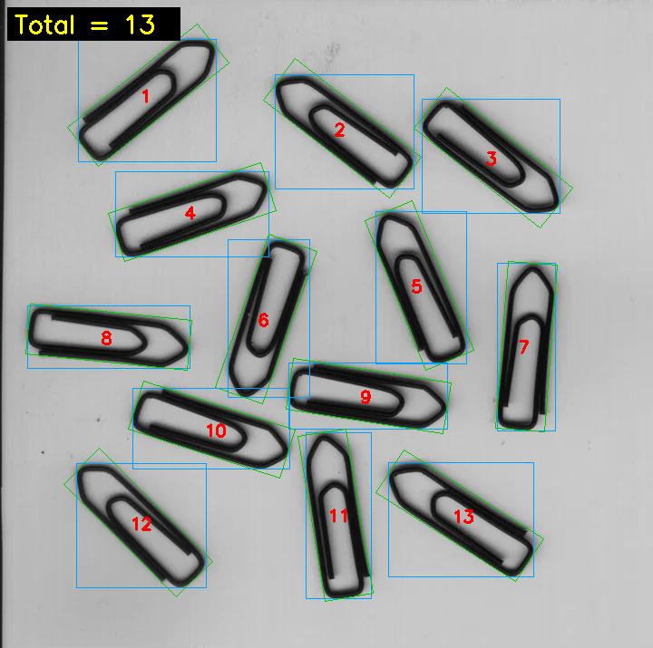

# 01 回形针计数（Paperclip Counting）

## 题目
识别并统计图中回形针的个数。

输入图：`images/clips.png` — 720 × 715，浅灰背景上散落着回形针，回形针是**暗色钢丝笔画**（中空，只有轮廓）。

## 结果



**共 13 个回形针。** 每个回形针标了序号，并画了两个框：
- 蓝色：连通域的外接正矩形
- 绿色：`minAreaRect` 最小外接**旋转**矩形（能看出每个回形针的摆放角度）

终端输出（节选）：
```
  clip 1  area=5092  center=(162,104)  size=183x54  angle=-38.66
  clip 2  area=5636  center=(376,141)  size=57x176  angle=-52.17
  ...
TOTAL PAPERCLIPS = 13
```

## 算法流程

| 步骤 | 处理 | 说明 |
|---|---|---|
| 1 | 转灰度 `cvtColor` | 只用亮度信息 |
| 2 | Otsu 自动阈值 + 反相 | 背景亮、钢丝暗 → `THRESH_BINARY_INV \| THRESH_OTSU`，本例阈值 116 |
| 3 | 形态学闭运算 3×3 | 一根回形针本身就是一条连续钢丝，天然是一个连通域；闭运算只负责补笔画上的小断口 |
| 4 | 连通域分析 | `connectedComponentsWithStats`，标签 0 是背景，其余每个连通域是一个候选回形针 |
| 5 | 过滤 | 面积 < 图幅 0.2% 的算噪点；**贴图片边框的直接丢弃** |
| 6 | 标注 | `minAreaRect` 求旋转矩形 + 编号 + 保存结果图 |

## 关键参数

| 参数 | 取值 | 作用 |
|---|---|---|
| 闭运算核 | `MORPH_ELLIPSE` 3×3 | 再大就会把相邻两个回形针粘成一个 |
| minArea | 图幅 × 0.002（约 1030 像素） | 噪点与真实目标的面积分界 |
| maxArea | 图幅 × 0.30 | 多个回形针粘连时的上限 |

## 踩过的坑

1. **图片左边缘有一条贯穿整幅高度的暗带**（6 像素宽，面积 2536）。Otsu 会把它当成一个"目标"，只按面积过滤会**多数 1 个（14 个）**。加上"贴边框的连通域丢弃"才得到正确的 13。
2. **闭运算核不能贪大**：试过 5×5、7×7，相邻回形针会被粘成一个整体，计数变少。
3. **`cv::putText` 只支持 ASCII**：图上写中文会变成问号，所以图上文字用英文，中文只写在注释里。

## 编译运行
见[根目录 README](../README.md)。
