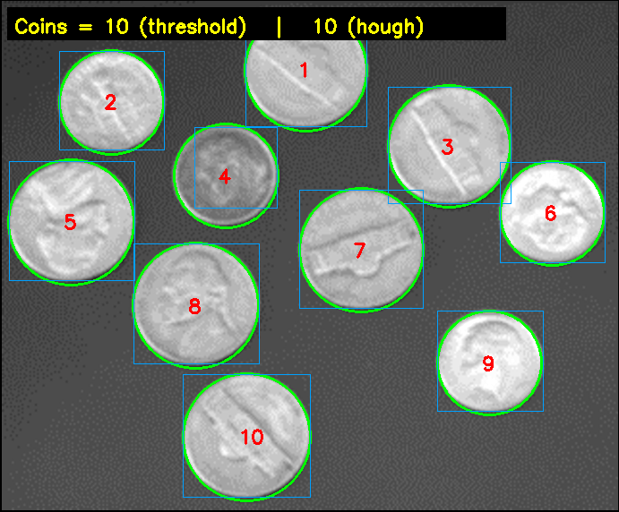

# 02 硬币识别与计数（Coin Detection & Counting）

## 题目
识别并统计图中硬币的数量，并给出每枚硬币的圆心和半径。

输入图：`images/coins.png` — 691 × 572，深灰带颗粒纹理的背景上散落着 10 枚银灰硬币，**其中一枚明显偏暗、对比度低**。

## 结果

**共 10 枚硬币。** 用两种方法独立检测，结果互相验证：

| 方法 | 思路 | 结果 |
|---|---|---|
| 方法一：阈值 + 连通域 | 前景分割后按面积过滤，再局部精化 | **10** |
| 方法二：霍夫圆变换 | `HoughCircles` 直接找圆，给圆心半径 | **10** |

另附霍夫圆结果图和二值化掩膜图：`result/coins_hough.png`、`result/coins_binary.png`。

## 算法流程

**方法一（主）**
| 步骤 | 处理 | 说明 |
|---|---|---|
| 1 | 灰度 + 高斯模糊 5×5 | 压掉背景颗粒噪点和硬币表面纹理 |
| 2 | Otsu 阈值（`THRESH_BINARY`） | 硬币亮、背景暗，本例阈值 133 |
| 3 | 开运算 5×5 | 去掉零散亮点，硬币本身大小基本不变 |
| 4 | 连通域 + 面积过滤 | 面积 < 0.2% 图幅算噪点，> 25% 算多枚粘连 |
| 5 | **局部 Otsu 精化** | 在每个硬币的小 ROI（外扩 10%）里**再 Otsu 一次**，把欠分割的那一枚真实边界找回来 |
| 6 | 最小外接圆 `minEnclosingCircle` | 得到圆心和半径，画绿圈 + 编号 |

**方法二（对比）**：`HoughCircles(HOUGH_GRADIENT, dp=1, minDist=图宽/12, param1=100, param2=30, minRadius=15, maxRadius=图宽/8)`

## 关键参数

| 参数 | 取值 | 作用 |
|---|---|---|
| 高斯核 | 5×5 | 背景噪点 vs 硬币边缘的折中 |
| 开运算核 | 5×5 椭圆 | 去噪点，不改变硬币大小 |
| minArea / maxArea | 0.2% / 25% 图幅 | 噪点与粘连的边界 |
| Hough param2 | 30 | 累加器阈值：小→误检多，大→漏检 |
| Hough minDist | 图宽 / 12 | 防止同一枚硬币检出多个圆 |

## 踩过的坑

**全局阈值对"偏暗的那枚硬币"欠分割** —— 这是本题最关键的一个坑。
全局 Otsu 阈值 133 下，那枚暗硬币只有中心一块超过阈值，连通域面积 4637，反推等效半径只有 **38 像素**（真实半径约 53~58），绿圈明显偏小、框不住整枚硬币。

解决办法是**局部精化**：在每个硬币的 bbox 外扩 10% 的小 ROI 里重新做一次 Otsu（这枚硬币的局部阈值只有 106，比全局的 133 低），面积恢复到 8915，最小外接圆半径 **58**，与霍夫圆给出的 53 基本一致。

这一条也顺带说明：**单靠一个全局阈值处理光照不均的画面是不可靠的，局部阈值 / 自适应阈值才是正解。**

## 编译运行
见[根目录 README](../README.md)。
