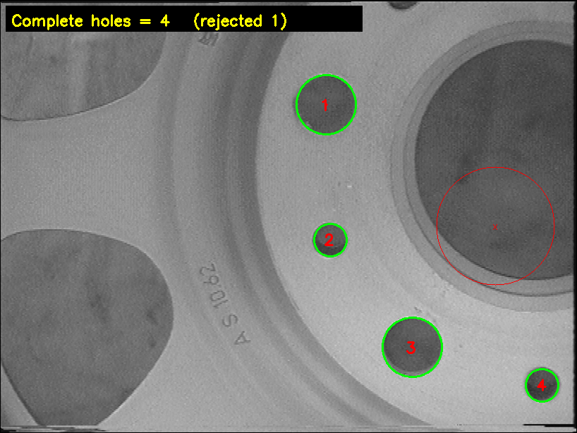

# 03 完整圆孔检测（Complete Circular Hole Detection）

## 题目
检测图中轮毂/法兰盘零件上的**小圆孔**，要求**只保留完整的圆**——被画面边缘切掉一部分的孔、以及辐条处的弧形槽，都不能算。

输入图：`images/holes.png` — 818 × 614 的零件灰度图，里面混着：
- 若干个小的螺栓孔
- 被图片边缘切掉一部分的孔（上边缘、右下角）
- 左侧的辐条弧形减重槽（形状不是圆）
- 右侧的中心大孔（也是一个圆，但被画面切掉，且不是"小孔"）

## 结果



**检测到 4 个完整的圆孔**，同时淘汰了 1 个不完整候选。

终端输出：
```
candidates from HoughCircles : 5
  hole 1  center=(461,148)  r=42  coverage=95%
  hole 2  center=(467,339)  r=23  coverage=100%
  hole 3  center=(583,492)  r=42  coverage=100%
  hole 4  center=(768,545)  r=23  coverage=100%
  REJECT (702,320) r=84  coverage=23%  -> circle not complete
complete circular holes = 4
rejected candidates    = 1
```

图上：**绿色粗圆** = 判定为完整的圆孔，**红色细圆 + ×** = 被淘汰的候选（右侧大孔边缘的那段弧，圆周覆盖率只有 23%，一眼能看出为什么不合格）。

## 算法流程

| 步骤 | 处理 | 说明 |
|---|---|---|
| 1 | 灰度 + 高斯模糊 7×7 | 压掉金属表面的车削纹理 |
| 2 | Sobel 求梯度幅值图 | 后面判断"圆周上到底有没有边缘"的依据 |
| 3 | `HoughCircles` 多召回 | `param2` 故意压到 18，宁可多检，靠后面过滤去伪 |
| 4 | **边框检查** | 圆只要有一部分超出画面 → 丢弃（被切掉的孔不算完整的圆） |
| 5 | **完整度检查** | 沿圆周采样 180 个点，每点在梯度图上判断"是否有边缘"（半径允许 ±2px 抖动，抵消像素量化误差），覆盖率 ≥ 90% 才算完整的圆 |
| 6 | 标注 | 通过=绿圈+编号；淘汰=红细圈+× |

## 关键参数

| 参数 | 取值 | 作用 |
|---|---|---|
| 高斯核 | 7×7, σ=1.5 | 兼顾去纹理和保留孔边 |
| Hough param1 | 100 | Canny 高阈值 |
| Hough param2 | **18** | 多召回：先全捞出来，再靠完整度检查去伪 |
| minRadius / maxRadius | 8 / 90 | 限定"小孔"范围，排除中心大孔 |
| 采样点数 SAMPLES | 180 | 2° 一个采样点 |
| 边缘阈值 EDGE_TH | 40（梯度幅值） | 认为"这里确实有边缘"的门槛 |
| 最低覆盖率 | **90%** | 完整的圆≈100%，弧槽只有 20~40%，界限很清楚 |

## 踩过的坑

1. **不能直接把 HoughCircles 的结果当答案**：`param2` 大一点（30~40）即刻漏检小孔，小一点（18）又会把中心大孔的一段弧当成圆。参数永远调不到"刚好只有真圆"，所以必须**先多召回、再用几何判据过滤**。
2. **"完整"要用可量化的判据**：光看 `HoughCircles` 的输出没法知道圆有多少部分是真实的。用"圆周采样 + 梯度覆盖率"把这件事变成一个数字：真圆 ≈ 100%，弧段 20~40%，阈值放在 90% 几乎不会误判。
3. **±2px 半径抖动是必要的**：Hough 给的整数半径和真实边缘常差 1~2 像素，不做容差会让覆盖率被无故拉低，真圆被误杀。
4. **贴边框的孔必须单独判**：这类孔的边缘信息是"真的"，覆盖率可能也不低，只能靠"圆是否完全落在画面内"这个几何条件排除。

## 编译运行
见[根目录 README](../README.md)。
