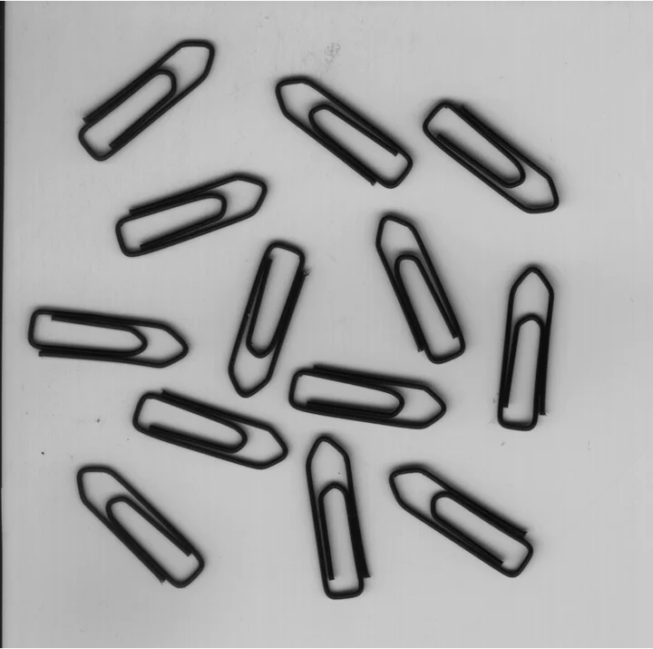
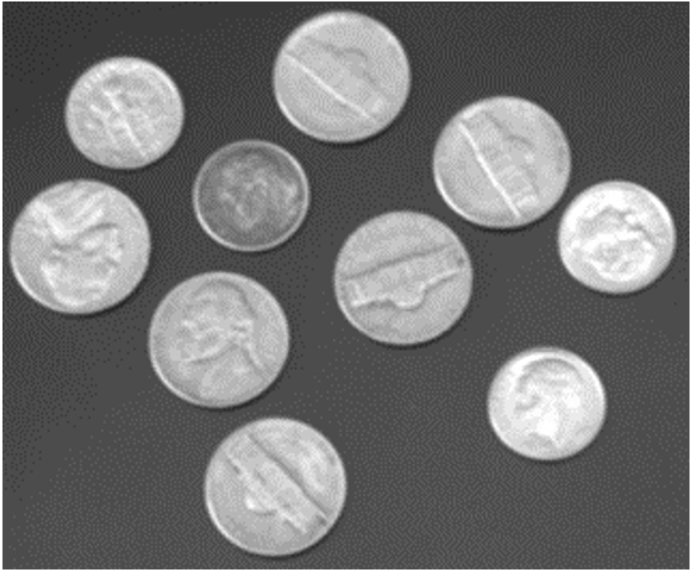
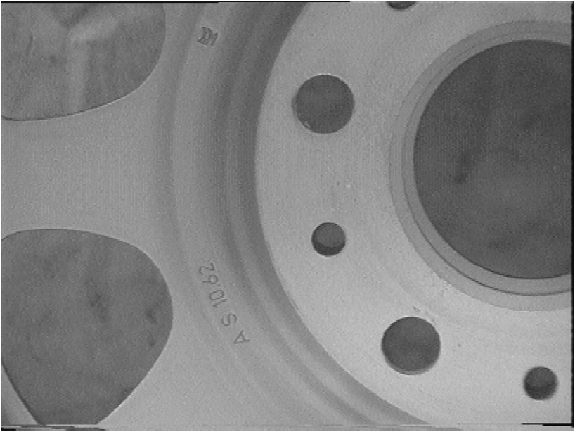
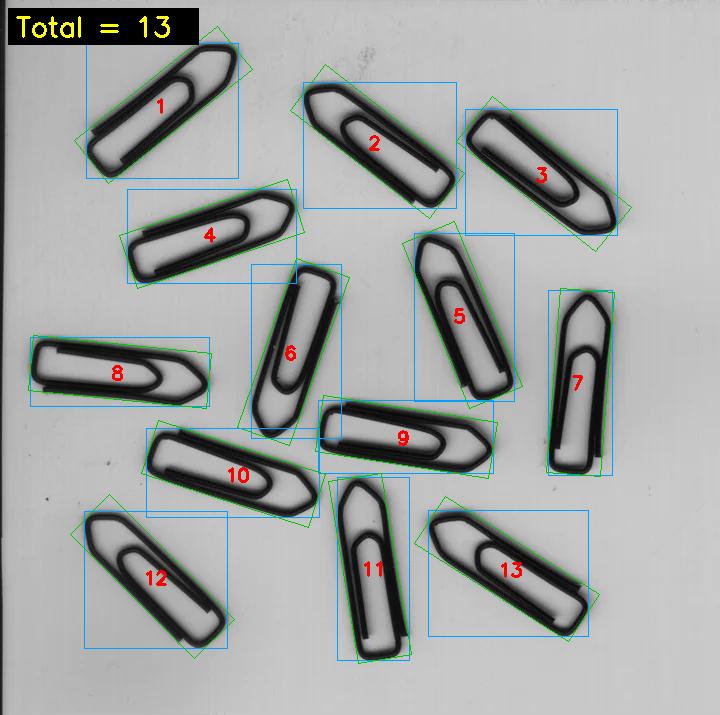
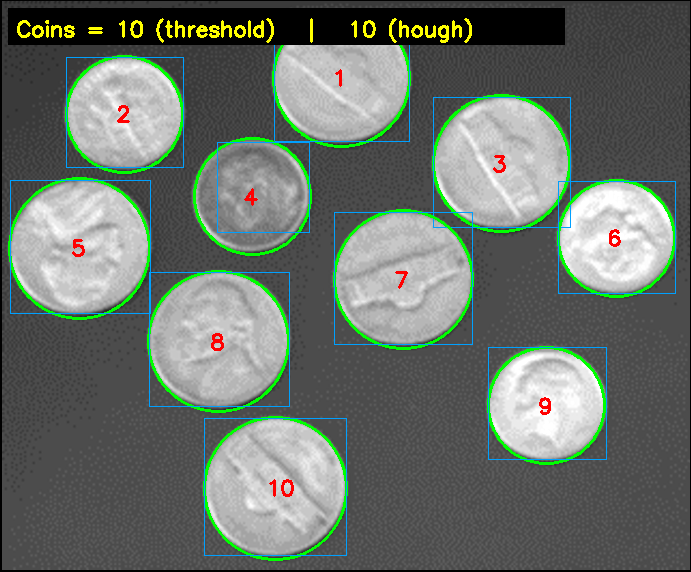
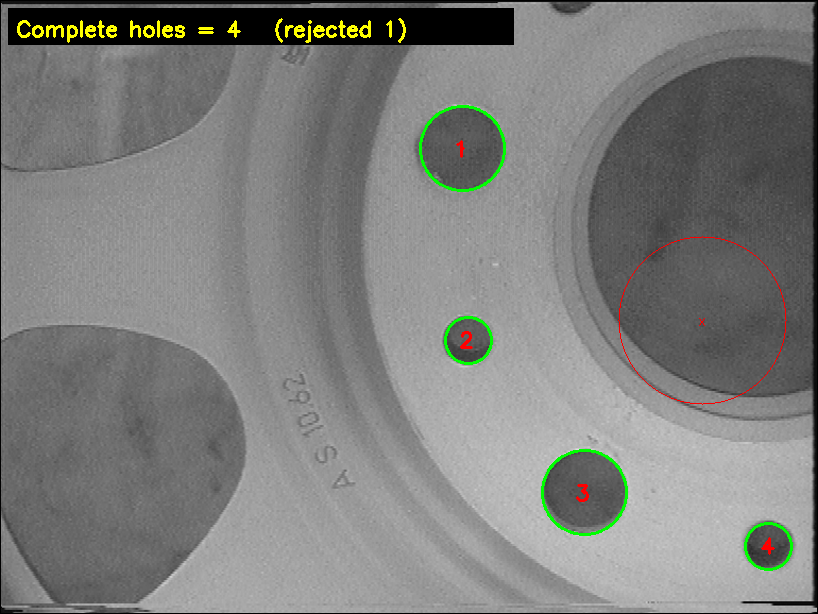

# 机器视觉技术及应用 · OpenCV 图像处理作业

三道 OpenCV（C++）图像识别作业，**每题一个独立可编译工程**，各自带输入图、源代码、结果图。

| # | 作业 | 输入图像 | 方法 | 结果 |
|---|------|----------|------|------|
| 01 | [回形针计数](01-paperclip-count/) |  | 灰度 + Otsu 反相二值化 + 闭运算 + 连通域分析 | **13 个** |
| 02 | [硬币识别与计数](02-coin-count/) |  | Otsu + 连通域 + 局部 Otsu 精化，并用 HoughCircles 互验 | **10 枚** |
| 03 | [完整圆孔检测](03-hole-detect/) |  | HoughCircles 多召回 + 边框检查 + 圆周完整度检验 | **4 个完整圆孔** |

## 结果一览

**01 回形针计数 → 13 个**



**02 硬币识别与计数 → 10 枚（两种方法结果一致）**



**03 完整圆孔检测 → 4 个（绿=完整圆，红×=淘汰的不完整候选）**



## 目录结构

```
.
├── 01-paperclip-count/
│   ├── main.cpp            # 源码
│   ├── CMakeLists.txt      # 独立工程
│   ├── images/clips.png    # 输入图
│   ├── result/             # 结果图（程序自动生成）
│   └── README.md           # 思路 / 参数 / 踩坑
├── 02-coin-count/
├── 03-hole-detect/
└── README.md
```

## 环境

| 项 | 版本 |
|---|---|
| 系统 | Windows 11 (x64) |
| 编译器 | Visual Studio 2022 (MSVC v143) |
| 构建 | CMake 3.20+ |
| 视觉库 | OpenCV 4.x（Windows 预编译包，x64/vc16） |

## 编译运行

每个子目录都是**独立工程**，进入任意一个目录即可编译：

```bash
cmake -S . -B build -G "Visual Studio 17 2022" -A x64 -DOpenCV_DIR=<你的OpenCV路径>/build
cmake --build build --config Release
build/Release/PaperclipCount.exe      # 或 CoinCount.exe / HoleDetect.exe
```

也可以直接用 VS2022 打开 `build/*.sln` 按 F5（工程已设好默认启动项）。
`CMakeLists.txt` 的 POST_BUILD 会把 OpenCV 的 dll 拷到 exe 旁边，双击 exe 也能直接运行。

> 说明：`CMakeLists.txt` 里的 `OpenCV_DIR` 默认写的是本机路径 `D:/opencv/build`，换机器请改成自己的 OpenCV 路径。

## 三个作业共同的技术路线

1. **先分割前景**：Otsu 全局阈值（回形针/硬币是"暗背景上的亮物体"或"亮背景上的暗细线"，分别用 `THRESH_BINARY` / `THRESH_BINARY_INV`）
2. **再做形态学去噪**：开运算去掉零散噪点，闭运算补断口，核大小是精度的关键
3. **最后量化判断**：连通域面积过滤 / 最小外接圆、旋转矩形 / 霍夫圆变换
4. **对"不完整目标"要单独判据**：03 题用"圆周采样边缘覆盖率 + 边框检查"把被画面切掉的、以及只是圆弧的目标全部排除
